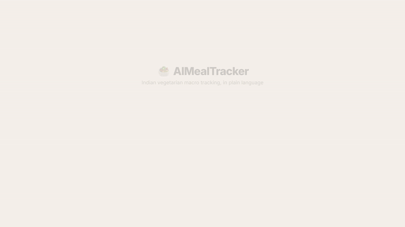

# 🥗 AIMealTracker

<div align="center">

[](https://parthh.runs-on.dev)
[](https://opensource.org/licenses/MIT)
[](https://anthropic.com)
[](https://vitejs.dev)
[](https://github.com/parthmishra9942/Ai-Meal-Tracker)
[](https://ai-meal-tracker.vercel.app/)

<h3>Natural-Language Macro & Nutrition Tracker for Indian Vegetarian Home Cooking</h3>

<p align="center">
  <b>Because western calorie counters assume pre-packaged US barcoded food and choke on <i>"2 roti, dal tadka, paneer bhurji"</i>.</b>
</p>

</div>

---

## 🎬 Product Showcase

<div align="center">
  
  <p><i>Real-time natural language parsing → Instant Indian food itemization with precise macros.</i></p>
</div>

> 📹 **Full 4K Launch Video:** Check out [`media/brag.mp4`](media/brag.mp4) inside the repository or preview the high-res poster [`media/brag.jpg`](media/brag.jpg).

---

## ⚡ Why AIMealTracker?

Generic calorie trackers treat traditional Indian cooking as an unsolvable black box. Searching for *"dal"* forces you into dozens of generic, processed canned soups that skew your daily caloric intake by 30-50%. 

AIMealTracker uses **Anthropic's Claude 3.5 Sonnet** combined with a specialized **Indian home-cooking ontology** to break any colloquial dish description into authentic portion sizes, grams, and exact macronutrients.

### 📊 Competitive Matrix

| Capability | Generic Apps (MyFitnessPal, etc.) | Standard Food Databases | **AIMealTracker** |
| :--- | :---: | :---: | :---: |
| **Colloquial Dish Parsing** | ❌ Requires exact SKU match | ❌ Hardcoded strings | ✅ **Native Contextual NLU** |
| **Indian Portion Recognition** | ❌ "1 cup" or "100 grams" only | ❌ Unrealistic USDA portions | ✅ **Phulkas, Katoris, Laddus** |
| **Preparation Style Nuance** | ❌ Ignores tadka / ghee / oil | ❌ Static raw ingredients | ✅ **Adjusts for home cooking styles** |
| **Privacy & Infrastructure** | ⚠️ Centralized telemetry | ⚠️ Cloud login mandatory | 🔒 **100% Client-Side (Zero DB)** |
| **Latency & Friction** | 🐌 6+ clicks per meal item | 🐌 Endless search pagination | ⚡ **1 sentence &lt; 800ms** |

---

## 🏗️ 3D System Architecture Diagram

```
                ┌─────────────────────────────────────────┐
                │   User Natural Language Meal Input      │
                │  "2 roti, dal tadka, 100g paneer sabzi"  │
                └────────────────────┬────────────────────┘
                                     │
                                     ▼
 ┌────────────────────────────────────────────────────────────────────────┐
 │                      AIMealTracker Client Shell                         │
 │                                                                        │
 │  ┌────────────────────────┐            ┌────────────────────────────┐  │
 │  │ API Key Vault          │            │ LocalStorage Data Store    │  │
 │  │ (Local Browser-Only)   │            │ Daily Totals & Historical  │  │
 │  └───────────┬────────────┘            └─────────────▲──────────────┘  │
 └──────────────┼───────────────────────────────────────┼─────────────────┘
                │ Direct HTTPS Client Request           │ Update Reactive
                ▼ (No intermediary server)              │ State
 ┌──────────────────────────────────────────────────────┴─────────────────┐
 │               Claude 3.5 Sonnet NLP Engine Orchestrator                │
 │                                                                        │
 │  • Extract Individual Food Entities & Colloquial Quantities            │
 │  • Apply Indian Home-Cooking Portion Heuristics (Katori, Ghee, Flour)  │
 │  • Compute Macronutrient Breakdown (Protein, Carbs, Fat, Kcal)        │
 │  • Enforce Strict JSON Schema Contract                                 │
 └────────────────────────────────────────────────────────────────────────┘
```

---

## 🚀 Interactive Prompt Parsing Examples

Try pasting any of these into the input bar:

```bash
# Complex Lunch
"2 butter roti, 1 katori arhar dal tadka, bhindi sabzi, and a small cup of curd"

# Post-Workout High-Protein Snack
"250ml milk with 1 scoop whey, 5 soaked almonds, and 2 bananas"

# Sunday Breakfast
"2 aloo paratha with 1 spoon butter, mint chutney, and ginger tea with sugar"
```

Each input is dynamically structured into:

```json
{
  "items": [
    {
      "name": "Roti (with butter)",
      "quantity": "2 pieces (approx 60g flour + 5g butter)",
      "calories": 210,
      "protein_g": 6.2,
      "carbs_g": 34.0,
      "fat_g": 5.5
    },
    {
      "name": "Arhar Dal Tadka",
      "quantity": "1 medium katori (approx 150ml)",
      "calories": 165,
      "protein_g": 8.5,
      "carbs_g": 22.0,
      "fat_g": 4.8
    }
  ],
  "totals": {
    "calories": 375,
    "protein_g": 14.7,
    "carbs_g": 56.0,
    "fat_g": 10.3
  }
}
```

---

## 🛠️ Quickstart

### Prerequisites
- [Node.js](https://nodejs.org/) (v18.0.0 or higher)
- [Anthropic API Key](https://console.anthropic.com/)

### Installation & Run

```bash
# 1. Clone the repository
git clone https://github.com/parthmishra9942/Ai-Meal-Tracker.git
cd Ai-Meal-Tracker

# 2. Install dependencies
npm install

# 3. Start local development server
npm run dev
```

Visit `http://localhost:5173` in your browser. On initial launch, input your Anthropic API key—it is safely stored in `window.localStorage` and never leaves your browser.

---

## 🔒 Security & Privacy

- **Zero Cloud Databases:** All your meal logs, dates, and historical aggregates live solely in your browser's `localStorage`.
- **Direct API Link:** Requests travel directly from client browser $\to$ `api.anthropic.com`. There are zero middleman tracking proxies.
- **Auditable:** Complete source code is open, unminified in development, and free of hidden telemetry.

---

## 👨‍💻 Author

**Parth Mishra**  
- GitHub: [@parthmishra9942](https://github.com/parthmishra9942)  
- Portfolio: [parthh.runs-on.dev](https://parthh.runs-on.dev)  
- LinkedIn: [linkedin.com/in/parth-mishra-4b7578242](https://linkedin.com/in/parth-mishra-4b7578242)

---

## 📄 License

Distributed under the **MIT License**. See `LICENSE` for more information.
